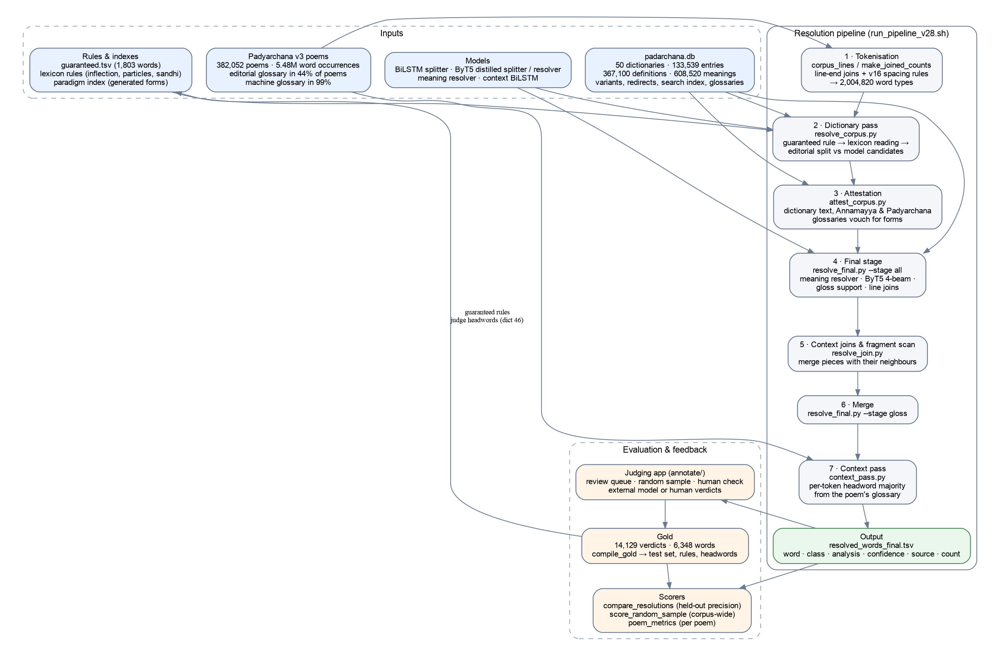
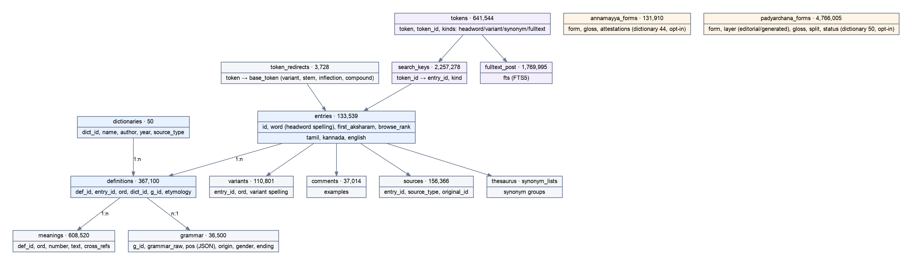
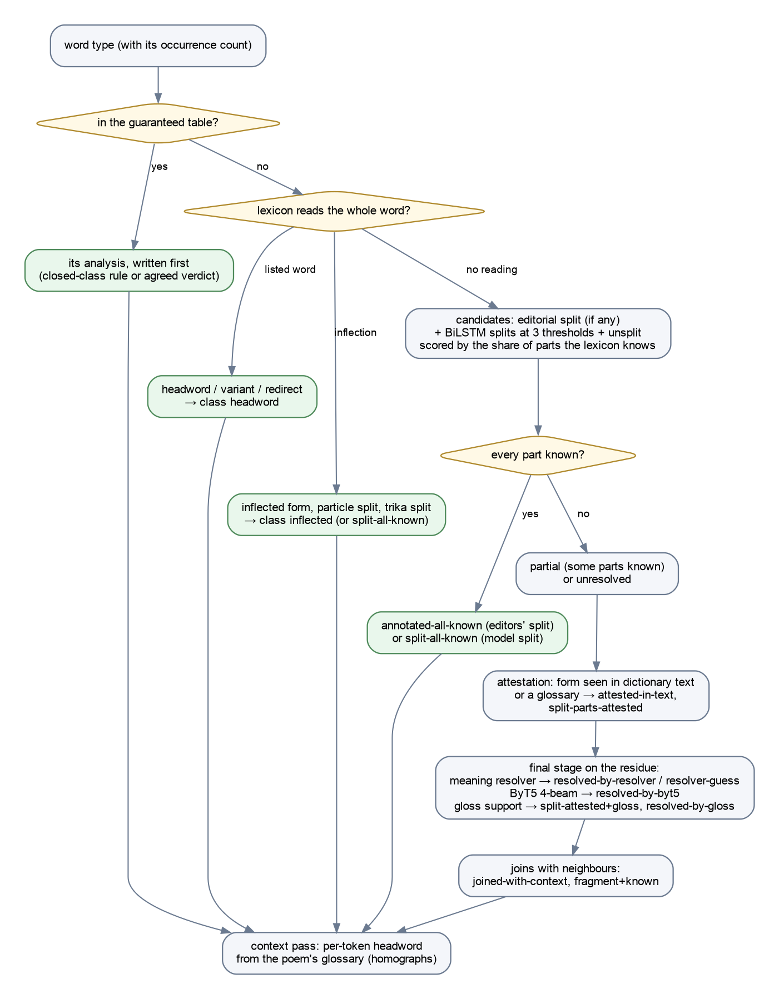
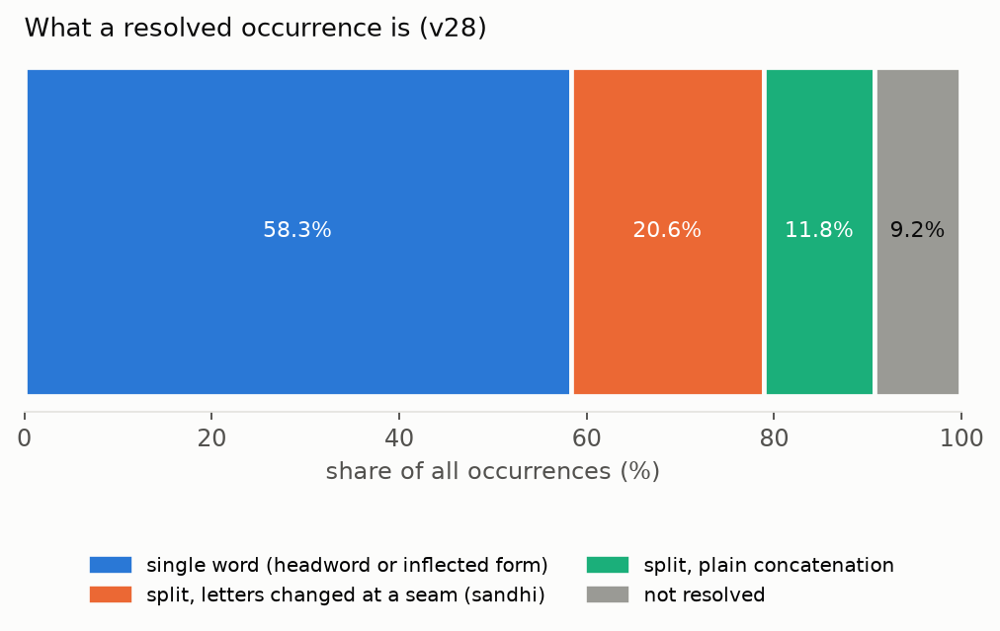
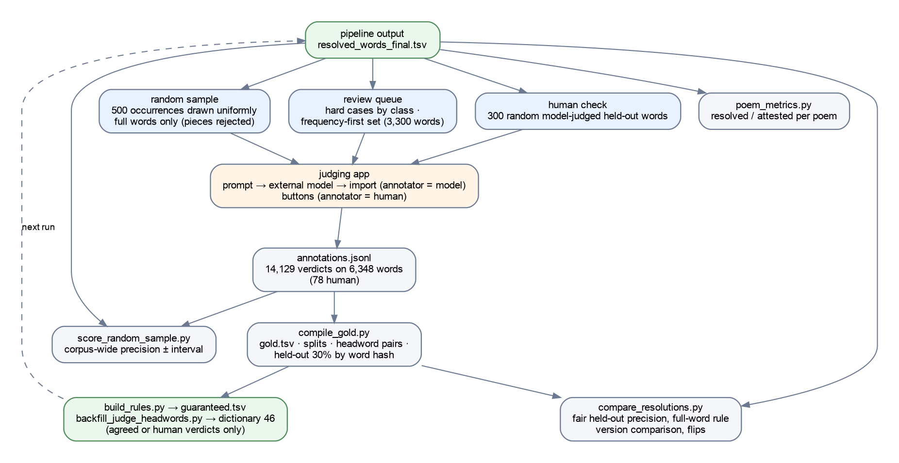
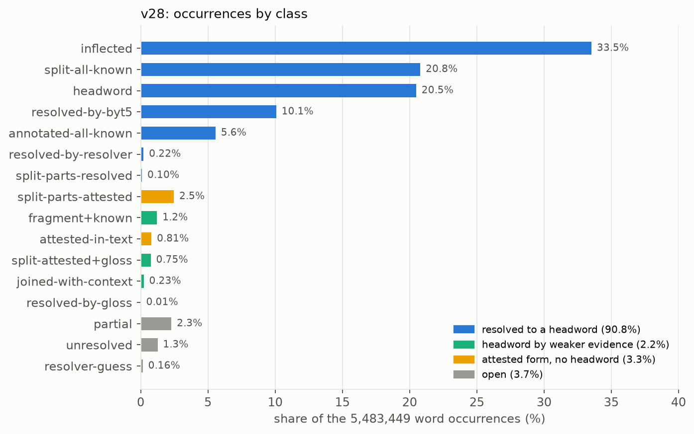
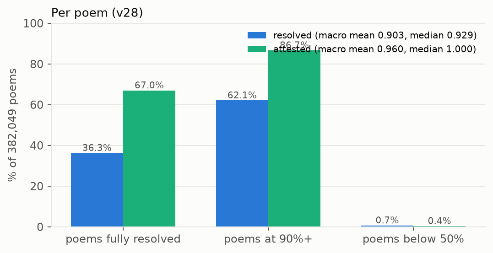
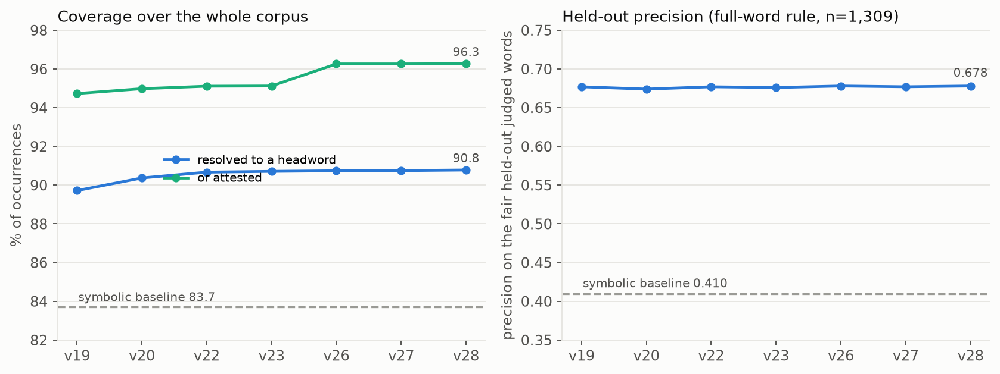
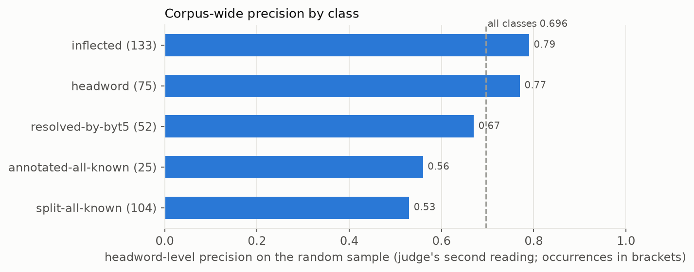
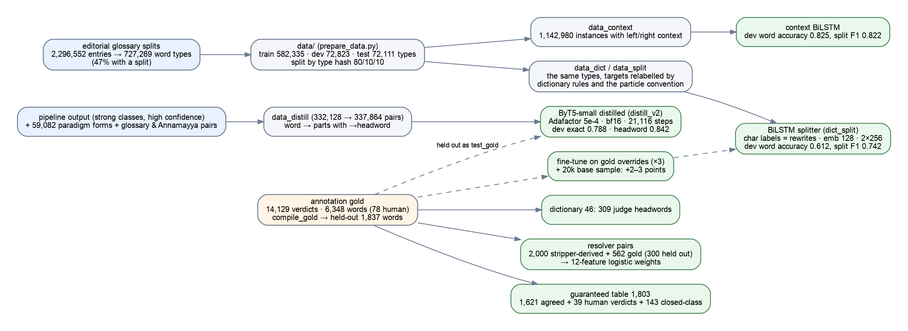

# Word Resolution for Padyarchana: Design, Data, Metrics and Results

*Report of the word-resolution system that links every word of the Padyarchana corpus of Telugu poetry to a dictionary
headword in padarchana.db. State as of 28 October 2026 (pipeline version v28); sections 12 to 15 (30–31 October) give the
metric, the training mechanisms, the datasets, and definitions written for reuse in other documents. Companion files: `figures/` (diagrams
and charts), `../bilstm/README.md` (the dated engineering log), `../gemini_design/EVALUATION.md` (the symbolic
sandhi engine).*

## 1. Summary

**The task.** Padyarchana holds 382,052 Telugu poems. Word resolution attaches to each of their 5,483,449 word
occurrences the dictionary headword (or headwords, for a compound) it stands for, so that padarchana.db's definitions,
grammar and meanings can be shown for any word of any poem. Classical Telugu makes this hard: words carry inflection,
sandhi joins neighbouring words and changes letters at the seam, long Sanskrit compounds chain several stems, and the
printed editions break words with spaces and line ends.

**The system.** A neuro-symbolic pipeline: a dictionary-backed lexicon with inflection and sandhi rules, a guaranteed
table of confirmed answers, two neural splitters (a BiLSTM and a distilled ByT5), a meaning resolver, attestation and
gloss evidence from the dictionaries' own text and from the poems' word-by-word glossaries, line and space joins, and a
per-poem context pass. Its output is one table: for every word type, a class, an analysis (the parts and their
headwords), a confidence and a source.

**Where it stands (v28).** 90.8% of occurrences resolve to a headword; 93.0% counting weaker gloss-based evidence;
96.3% are at least attested. Per poem, the median poem has 92.9% of its words resolved, 36.3% of poems are fully
resolved and 62.1% are at 90% or more. On the corpus-wide random sample the headword-level precision of the resolved
words is 0.70 to 0.84 depending on which of the external judge's two readings is believed; on the hard held-out judged
words it is 0.678 under the full-word rule, against 0.410 for a dictionary-and-rules baseline run over the same corpus.

**What the measurement rests on.** 14,129 verdicts on 6,348 words, almost all from an external model acting as judge
(78 by hand), a 500-occurrence random sample of full words, and three scorers. The remaining weakness is the judge: its
two readings disagree on a third of the words, and a human pass on a 300-word calibration set is pending.



*Figure 1. The resolution pipeline, its inputs and the evaluation loop.*

## 2. Definitions

**Occurrence, type, token.** An *occurrence* is one word in one poem line; the corpus has 5,483,449. A *type* is a
distinct spelling; there are 2,004,820. A *token* is what the tokeniser hands the pipeline: a space-separated string of
the edition, after the line-end joins and the spacing rules of section 5.2.

**Word at source (the full word).** The word as it stands in the poem, which the edition may have broken with a space
or a line end (హృదయుఁడగుచు for కందళితహృదయుఁడగుచు; రిమితముగ for నపరిమితముగ across a line break). By the rule set on
26 October 2026, the unit of sampling and of evaluation is the full word at source, never a piece of it.

**Headword.** An entry of padarchana.db (`entries.word`), the spelling under which the dictionaries define a word.
Comparison is at the *lexeme* level: a final -ము / -ం / -ు / -ుడు spelling difference is not a different word
(కార్యం = కార్యము).

**Analysis.** The pipeline's reading of a word: either the word itself (a headword), an arrow to its headword
(వెలసె→వెలయు), or a split into parts with their headwords (ఆత్మ+మందిరమున; కైకొన్న→కైకొను+ఎఱు). A part without an arrow is
a dictionary word as it stands.

**Resolved.** The occurrence's word has a headword for every part, from one of the strong classes of table 1.
**Attested**: resolved, or a headword by weaker evidence (a gloss, a context join, a fragment with a known base), or a
form the dictionaries' own text or a glossary vouches for. **Open**: everything else.

**Sandhi.** The sound changes where words meet: a final short vowel dropped before a vowel (రాముడు + అతడు → రాముడతడు),
a glide inserted (మా + అమ్మ → మాయమ్మ), the initial consonant of a word voiced after a vowel (కను → గను), the drutam న్
voicing what follows (తోడన్ + చనిన → తోడఁజనిన), Sanskrit assimilation inside compounds (సత్ + భక్తి → సద్భక్తి). Resolving
a split means undoing these.

**Classes.** Table 1 lists the classes the output table uses, the stage that produces each, and whether it counts as
resolved, attested or open.

*Table 1. Output classes (v28 shares of occurrences).*

| class | meaning | stage | counts as | share |
|---|---|---|---|---|
| inflected | an inflected form of a headword, or a word plus a particle | dictionary pass | resolved | 33.5% |
| split-all-known | a model split whose parts are all dictionary words | dictionary pass | resolved | 20.8% |
| headword | the word is a headword (or variant, redirect, synonym) as it stands | dictionary pass | resolved | 20.5% |
| resolved-by-byt5 | the distilled ByT5 resolver's reading, four beams | final stage | resolved | 10.1% |
| annotated-all-known | the editors' split, all parts known | dictionary pass | resolved | 5.6% |
| resolved-by-resolver | the meaning resolver's reading, accepted | final stage | resolved | 0.2% |
| split-parts-resolved | a split whose parts the resolver read | final stage | resolved | 0.1% |
| split-parts-attested | a split whose parts are headwords or attested forms | attestation | attested | 2.5% |
| fragment+known | a piece whose own part is known, the rest belongs to the neighbour | joins | attested (gloss) | 1.2% |
| attested-in-text | an unsplit word that occurs in the dictionaries' text or a glossary | attestation | attested | 0.8% |
| split-attested+gloss | a split supported by the poem's gloss | final stage | attested (gloss) | 0.8% |
| joined-with-context | resolved after joining with a neighbouring token | joins | attested (gloss) | 0.2% |
| resolved-by-gloss | a headword chosen from the gloss | final stage | attested (gloss) | 0.0% |
| partial | a split with some parts unknown | dictionary pass | open | 2.3% |
| unresolved | nothing applied | — | open | 1.3% |
| resolver-guess | the resolver's reading, below acceptance | final stage | open | 0.2% |
| proper-noun-like | shaped like a name | final stage | open | 0.0% |

## 3. The corpus: Padyarchana v3

*Table 2. Corpus figures.*

| | |
|---|---|
| poems | 382,052 (two JSON files, 2.4 GB; one object per poem: text, lines, meter, poet, source, glossaries) |
| word occurrences (pipeline tokens) | 5,483,449 |
| word types | 2,004,820 |
| poems with a word-by-word glossary | 380,358 (99.6%): 168,006 with both layers, 1,600 editorial only, 210,752 machine only, 1,694 none |
| editorial glossary (human) | 169,606 poems, 1,330,519 form-and-gloss pairs, 745,871 distinct forms, 413,280 distinct splits |
| machine glossary (gemini-3.5-flash-lite) | 378,758 poems, 3,437,778 pairs |
| poems by copyright-protected poets | 229,389 (60.3%): the corpus and anything derived from it per poem must not be published |
| largest sources | శంకరాభరణం online poems 99,530 + 10,837; రంగనాథ రామాయణం 26,296; శ్రీరామాయణం (కట్టా వరదరాజు) 23,292; శ్రీమదాంధ్ర మహాభారతము 21,400; శ్రీమదాంధ్ర మహాభాగవతం 10,066 |

**The glossary (prathipadārtham).** Each entry gives a word as it stands in the poem, an optional sandhi split
(వేమననగ: వేమన + అనగ) and a modern-Telugu meaning (యోగి: జ్ఞాని). It is a usage glossary, not a dictionary: it gives
meanings, not headwords, its forms are inflected, and in a glossed poem only 58% of tokens have an entry for exactly that
token. The editorial layer is human-made; the machine layer agrees with the editors on 65% of splits and 68% of
headwords where both exist, and is used only as evidence (section 6.7), never as an answer.

**What the corpus demands of a resolver.** Of the resolved occurrences in v28, 58% are single words (a headword or an
inflected form) and 42% are compounds or sandhi-joined sequences the pipeline had to split: 20.6% of all occurrences are
splits where letters changed at a seam, 11.8% are plain concatenations (section 7.3). Resolved words have 2 parts in
1.29M cases, 3 in 333k and 4 or more in 162k.

## 4. The dictionary database: padarchana.db



*Figure 2. Tables of padarchana.db with row counts.*

padarchana.db (SQLite, 1.61 GB) merges fifty Telugu dictionaries into one entry table with per-dictionary definitions.

*Table 3. Main tables.*

| table | rows | contents |
|---|---|---|
| dictionaries | 50 | the dictionaries: name, author, year, source type |
| entries | 133,539 | one row per headword spelling (the dictionaries' own spellings, e.g. ౘదువు, కనఁబడు) |
| definitions | 367,100 | one row per (entry, dictionary): grammar reference, etymology |
| meanings | 608,520 | the definition texts, numbered senses, cross-references |
| grammar | 36,500 | part of speech (విశేష్యము, క్రియ, …), gender, ending, origin (దేశ్యము, తత్సమము) |
| variants | 110,801 | alternative spellings of an entry |
| token_redirects | 3,728 | a token → its base entry (variant, stem completion, inflection, compound) |
| sources, comments, examples | 156,366 / 37,014 | provenance per entry; printed headwords and examples |
| tokens, search_keys, fulltext_post, fts | 641,544 / 2.26M / 1.77M | the search index: every Telugu word in headwords, variants, synonyms and definition text (rebuilt 26 Oct 2026) |
| thesaurus, synonym_lists | | synonym groups (the lexicon reads their members as dictionary words) |
| annamayya_forms | 131,910 | the Annamayya usage glossary (dictionary 44): forms with glosses and attestation counts, opt-in |
| padyarchana_forms | 4,766,005 | the Padyarchana glossary (dictionary 50): editorial and machine layers, form, split, gloss, the lexicon's reading; opt-in |

**The dictionaries.** Forty-three are published Telugu dictionaries of 1879 to 2010: the large general ones
(వావిళ్ల నిఘంటువు 40,563 definitions; శ్రీహరి 28,810; శంకరనారాయణ 28,177; శబ్దరత్నాకరము 25,823; బ్రౌణ్య 24,739; విజయ
17,555; తెలుగు నిఘంటువు 16,380), the Sanskrit-Telugu ones (ఆంధ్ర-సంస్కృత కోశము 14,384; సంస్కృత-ఆంధ్ర 3,521; సంస్కృత-తెలుగు
2,000), the verb-form dictionary క్రియాస్వరూప మణిదీపిక (7,308; its verb roots are also loaded directly), the dialect and
subject glossaries, and పురాణనామచంద్రిక (1,029 names). Seven were added during this work (table 4); each was measured
before being allowed into the lexicon, and most were kept out.

*Table 4. Dictionaries added in October 2026 and the decision on each.*

| id | source | size | in the lexicon? | measured effect |
|---|---|---|---|---|
| 44 | అన్నమయ్య పదనిఘంటువు (usage glossary) | 131,910 forms | opt-in, as attestation and gloss evidence only | glossary forms as lemmas were a known error source |
| 45 | ఆంధ్రభారతి crawl of missing headwords | 47 definitions, 23 new headwords | yes | 14,486 occurrences (0.26%): అనఘము, కర్మము, ఇచట |
| 46 | judge-backfilled headwords (from verdicts) | 309 definitions | yes, as a fallback behind the established dictionaries | +0.7 points coverage, precision flat; used by 1.6% of occurrences (లేదు, సకలము, కనుంగొను) |
| 47 | బ్రౌణ్య, DSAL digital edition | 6,056 (5,894 new) | no (v21) | with 48: coverage +1.8 points, held-out precision 0.645 → 0.620 |
| 48 | Telugu Wiktionary | 16,640 | no (v21) | fragments and syncopated spellings claimed as headwords |
| 49 | పదబంధ పారిజాతము (idioms, 1961) | 18,599 (8,025 single words, 10,546 phrases) | no (v24) | coverage +0.03 points; its compound headwords clash with the editors' splits |
| 50 | Padyarchana glossary | 20,216 definitions + the forms table | headwords no (v25: precision −0.6); glosses yes, as evidence (v26) | as evidence: attested +1.1 points, held-out +2 / −0 |

**Lessons.** Curated additions of a few hundred confirmed words pay off cleanly; bulk imports buy coverage with
precision. The dictionary is no longer the bottleneck of resolution.

## 5. How the problem was approached

### 5.1 From a splitter to a resolver

The work began as a sandhi-splitting model: a character BiLSTM trained on the editors' splits (token-weighted word
accuracy 0.78 to 0.83 on held-out editorial splits), then a ByT5-small distilled from the pipeline (`byt5/`). A split
alone does not answer the question the corpus asks, which is "which dictionary word is this", so the splitter became
one stage of a resolver whose other stages are symbolic: the lexicon reads whole words and inflections; a guaranteed
table writes confirmed answers first; attestation checks forms against the dictionaries' own text; a resolver matches
meanings; joins repair the editions' broken words; a context pass chooses among homographs per poem.

### 5.2 Tokenisation decisions

The editions break words. Two rules fixed on 13 October (v16) make the token base: a line-end token and the next
line's first token are merged when the line ends with a hyphen or when the merged form is a dictionary word (the
merge decisions are recorded, 435,562 space-join records); and inside a line, a token is joined after an arasunna and
before a single akshara (మాట లెల్ల → మాటలెల్ల). Every stage and every comparison uses this one token base
(`results/padyarchana/poem_word_counts_joined.tsv`).

### 5.3 The version history

*Table 5. The versions, what changed, and the result (re-scored on 28 Oct under one scorer: resolved share of
occurrences; precision on the 1,309 fair held-out judged words under the full-word rule).*

| version | date | change | resolved | held-out precision |
|---|---|---|---|---|
| v1–v11 | 7–11 Oct | BiLSTM splitter; dictionary pass; attestation; line joins; meaning resolver | — | — |
| v12–v13 | 12 Oct | the distilled ByT5 as splitter, then as a resolver stage | — | — |
| v14–v15 | 12–13 Oct | retrain cycle on the gold; ByT5 on the whole residue with 4 beams | — | — |
| v16–v17 | 13 Oct | spacing rules; retrain on the cleaned gold (plateau reached) | 0.896 | — |
| v18–v19 | 13 Oct | guaranteed table; per-token context pass | 0.897 | 0.677 |
| v20 | 14 Oct | judge headwords (dictionary 46) as a fallback | 0.904 | 0.674 |
| v21 | 14 Oct | DSAL Brown and Wiktionary in the lexicon: rejected | 0.922 | lower |
| v22 | 14 Oct | syncope and consonant-stem rules; fairer scoring of split parts | 0.907 | 0.677 |
| v23 | 25 Oct | four rules adapted from the sandhi-engine evaluation | 0.907 | 0.676 |
| v24, v25 | 26 Oct | dictionaries 49 and 50 as headwords: neutral, rejected | 0.907, 0.908 | — |
| v26 | 26 Oct | the editorial glossary as attestation and gloss evidence | 0.907 | 0.678 |
| v27 | 26 Oct | gold recompiled: 36 rules, 18 headwords | 0.908 | 0.677 |
| v28 | 26 Oct | agreed verdicts as rules (300), judge headwords deferring to the editors' splits | **0.908** | **0.678** |
| symbolic baseline | 26 Oct | lexicon + sandhi rules only, no model, no evidence | 0.837 | 0.410 |

The precision column is flat across v19 to v28: the gains of the last two weeks were coverage (+1.1 points) and
corrected occurrences (the rules and headwords from verdicts), not precision on hard words, which has been limited by
the models and the dictionaries since v17.

### 5.4 Two outside systems

An 18-rule Bālavyākaraṇamu sandhi engine with a "word resolution metric" (`gemini_design/`) was evaluated on the
editors' splits and the judged words: it reproduces 44% of the editors' splits as written (59% with every rule
optional), its splitter proposes a boundary only where a sandhi change happened, its lattice search fragments known
words, and its precision on the judged words is 0.09 (own ranking) to 0.25 (with a parsimony rerank). Four of its rules
were adapted into the lexicon (v23). A whole-corpus symbolic baseline (section 8.5) uses its splitter with the
dictionary and nothing else.

## 6. Architecture

### 6.1 Stages

The run script (`bilstm/run_pipeline_v28.sh`) executes seven stages over the whole corpus in about 1 h 45 min.

1. **Tokenisation** (`corpus_lines.py`, `make_joined_counts.py`): poems → tokens with the joins of 5.2 → the type
   table with counts.
2. **Dictionary pass** (`resolve_corpus.py`, 35 min): for each type, the guaranteed table first; then the lexicon's
   reading of the whole word; then the editorial split, if the editors gave one and the word was not resolved by a
   judge-only headword, competing with the BiLSTM's split candidates at three thresholds and the unsplit reading, scored
   by the share of parts the lexicon knows. Output classes: headword, inflected, annotated-all-known, split-all-known,
   partial, unresolved.
3. **Attestation** (`attest_corpus.py`): promotes partial or unresolved words whose form occurs in the dictionaries'
   definition text or in the Annamayya or Padyarchana glossaries (attested-in-text, split-parts-attested).
4. **Final stage** (`resolve_final.py --stage all`, 35 min): on the residue, the meaning resolver (string similarity
   over the whole dictionary with a cosine gate), the ByT5 resolver with four beams (cached per word), gloss support from
   the poem's glossary, and line joins.
5. **Context joins and fragment scan** (`resolve_join.py`): a piece is joined with its neighbour when the join is a
   dictionary word or resolves; a fragment whose own part is known is recorded with the neighbour's tail.
6. **Merge** (`resolve_final.py --stage gloss`): the gloss-supported readings are merged into the table.
7. **Context pass** (`context_pass.py`): for every occurrence in a glossed poem, the headword the glossary implies;
   a type whose occurrences mostly point to a headword other than the table's is set to the majority (24,642 tokens in
   v28), which fixes homographs (గాదు → అగు, జంపి → చంపు).



*Figure 3. How one word type is resolved.*

### 6.2 The lexicon (`bilstm/lexicon.py`)

The lexicon turns a string into (status, headword, how). It normalises both sides (ౘ→చ, ౙ→జ, ఱ→ర, arasunna dropped),
then tries, in order: a direct entry, variant, redirect or synonym; the plural-case and plural-entry rules; Telugu
inflections stripped from the end (plural -లు, oblique -ల, case endings, -ంబు/-ము, -ఁడు/-డు, the drutam, verb endings,
converbs of -యు and -చు verbs, past forms with the ఇ-stem of a ఉ-root); the particles the project splits off
(-యు -తో -ను -అని -ఏ -ఐ -ఓ); a bare Sanskrit stem as used in a compound (ధర్మ → ధర్మము); the paradigm index, a SQLite
table of every headword's generated forms (`paradigm_forms.db`, 3.4 GB), used to confirm the stripper or to read a form
the stripper cannot; the initial-sandhi variants (a voiced initial devoiced, a య or న initial undone: జూచి → చూచు,
యని → అని, నొప్పున్ → ఒప్పున్); and the last resorts from the sandhi-engine evaluation: syncope (పల్కు → పలుకు), Sanskrit
consonant stems (జగత్ → జగత్తు), ఓ-stems and visarga (మనో → మనస్సు, దుః → దుర్), final-consonant unassimilation
(సద్ → సత్), త్రిక splits (ఇవ్విధంబున → ఈ + విధంబున) and the yadagama initial on a weak reading (యతని → అతడు). A headword
that only an added dictionary has reads a word only when the established dictionaries cannot, and never overrides the
editors' split.

### 6.3 The guaranteed table (`rules/guaranteed.tsv`, 1,803 words)

Closed-class words (pronouns, particles, verb forms) and the training-split verdicts that two judge readings or a
human confirmed, checked against the poems' glosses. The dictionary pass writes them before anything else runs; no
later stage revisits them. They are drawn from the training split only, so the held-out test never sees them.

### 6.4 Models

The BiLSTM splitter (`checkpoints/dict_split`, `context_bilstm`) proposes splits per character; the ByT5-small
distilled from the pipeline (`byt5/checkpoints/distill_v2`) proposes and resolves splits with four beams and is gated by
dictionary knowledge; the meaning resolver (`lcs_resolver.py`, `meaning_resolver.py`, with an embedding-gemma model)
matches a form to the dictionary by string similarity and meaning. The context BiLSTM reads the poem line.

### 6.5 Evidence rather than answers

Three sources are used only to confirm or choose, never to assert a headword: the dictionaries' own text (a form in a
definition or citation exists), the Annamayya glossary, and the Padyarchana editorial glossary (v26). This is the
distinction that decided dictionaries 47 to 50: as headwords they lowered precision; as evidence the glossary raised the
attested share by 1.1 points at no cost.

## 7. Sandhi

### 7.1 What the corpus contains



*Figure 4. Resolved occurrences by shape (v28).*

*Table 6. Resolved occurrences by shape.*

| shape | occurrences | share of the corpus |
|---|---|---|
| single word (headword or inflected form) | 3,198,170 | 58.3% |
| split where letters changed at a seam (sandhi) | 1,131,310 | 20.6% |
| split by plain concatenation (no change) | 648,638 | 11.8% |
| parts per resolved word: 2 / 3 / 4+ | 1,285,332 / 333,031 / 161,585 | |

### 7.2 How the pipeline handles it

Sandhi is undone at three places: inside the lexicon, for a whole token whose initial carries the previous word's
sandhi or whose final was changed (section 6.2); in the splitters, which learned the seams from the editors' splits
(the BiLSTM and ByT5 restore the underlying parts: విశ్వదాభిరామ → విశ్వద + అభిరామ); and in the joins, for words broken
by the edition. The judged words show the frequent patterns the lexicon handles well (vowel elision, voicing, the
drutam, the glide) and the ones the models carry (Sanskrit compounds).

### 7.3 What the rulebook alone covers

The 18-rule engine's forward join reproduces the editors' 413,280 splits as follows: 43.8% as written, 59.3% if every
rule is treated as optional, 60.3% with the య / న augment, 66.2% also allowing the previous token's sandhi on the initial;
33.8% are not coverable. On the joins it reproduces, the rules used are the elisions (ఉత్వ 54,802; అత్వ 20,543; ఇత్వ
5,320), గసడదవ voicing (7,716), త్రిక (930), యడాగమ (838), సరళాదేశ (539); nine of the eighteen rules fire 89 times in all.
Not covered: Sanskrit sandhi (సత్ + భక్తి → సద్భక్తి, జగత్ + అంబ → జగదంబ, visarga), the ఏ/ఓ clitic with shortening
(కాదు + ఏ → గాదె), productive nugagama (చూడఁగ + ఏల → చూడఁగనేల), and ౘ/ౙ. The engine over-applies voicing, -ంపు and -దు
to 12% of the editors' splits that are plain joins. The symbolic baseline built on it (section 8.5) resolves 83.7% of
occurrences at 0.41 precision: coverage is cheap, judgement is not.

## 8. Evaluation design and metrics



*Figure 5. How verdicts are collected and used.*

### 8.1 Coverage

The share of occurrences in a resolved class, over the whole corpus (every occurrence weighted once). Reported as three
widening bands: resolved to headwords; including gloss-based classes; or attested. It measures how many words got an
answer, not how many answers are right.

### 8.2 Per-poem resolution and attestation (`poem_metrics.py`)

For each poem, the share of its tokens resolved and the share attested; over the corpus, the macro mean (every poem once),
median, quartiles, the share of poems fully resolved and at 90%+, and the same by glossary layer and by source. Two
tables give a per-poem comparison (poems improved or worsened).

### 8.3 Judged-word precision (`compare_resolutions.py`)

A judge (an external model via the app's prompt, or a person via its buttons) reads the poem line and gives the full
word at source, its split and headwords. A system answer is *right* when its headword lexemes are a non-empty subset of
the judge's; unannotated split parts are read through the lexicon; a non-Telugu part is ignored. Scores are on the
*fair held-out* words: held out by a hash of the word (30%), with answers that use a judge-backfilled headword excluded
so the judges' own additions cannot inflate the score. Under the **full-word rule**, a piece is scored on the pipeline's
reading of its full word when the pipeline has it, and counts as unresolved when it never produced it; those cases are
reported beside the precision as a tokenisation gap. A second set, the judged words outside the gold table, is reported
for version comparison.

### 8.4 Corpus-wide precision: the random sample (`make_random_sample.py`, `score_random_sample.py`)

500 occurrences drawn uniformly from all 5.48 million, full words only (pieces rejected at draw time), judged on their
current analysis; verdicts count per occurrence. Reported: coverage among the judged, strict precision (the judge said
"correct"), headword-level precision, split-exact agreement, and "resolved and right" over all judged occurrences, each
with a Wilson 95% interval. This is the only figure that generalises to the corpus.

### 8.5 Baselines

The purely symbolic baseline (`symbolic_baseline.py`): the lexicon's reading, else a two-part split from the engine's
rules or a plain boundary accepted when both parts are known, with one more split of an unknown part; no model, no
attestation, no glossary, no context, run over all 2.0 million types (4.1 hours). The engine's own lattice search is the
second reference.

### 8.6 The judges

14,129 verdicts on 6,348 words: 78 by hand, the rest from the external model. The model's two readings of the same
words agree on 83% of the human-check words but, on the random sample, the second reading turned 89 "correct" verdicts
into "wrong" and 12 the other way. Only verdicts confirmed by a second reading or by a person enter the rules. The human
calibration pass (300 random model-judged held-out words, served by the app with the model's verdict shown) is the
pending step that decides which reading to trust.

## 9. Results

### 9.1 Coverage and classes (v28)



*Figure 6. Occurrences by class (v28).*

| | share of 5,483,449 occurrences |
|---|---|
| resolved to a headword | **90.78%** (4,977,000) |
| including gloss-based classes | 93.00% |
| or attested | 96.27% |
| open (partial, unresolved, guesses) | 3.73% |

### 9.2 Per poem (v28, 382,049 poems)



*Figure 7. Per-poem resolved and attested shares.*

| | macro mean | median | quartiles | poems at 100% | at 90%+ | below 50% |
|---|---|---|---|---|---|---|
| resolved | 0.903 | 0.929 | 0.857 / 1.000 | 36.3% | 62.1% | 0.7% |
| attested | 0.960 | 1.000 | 0.941 / 1.000 | 67.0% | 86.7% | 0.4% |

By layer: poems with a human glossary 0.908 resolved (0.972 attested), machine-only poems 0.899 (0.950). By source:
శంకరాభరణం 0.926, రంగనాథ రామాయణం 0.925, మహాభాగవతం 0.917, మహాభారతము 0.907, శ్రీరామాయణం (కట్టా) 0.895; the least resolved
collections with 200+ poems are the inscriptional శాసనపద్యమంజరి (0.690), రతిరహస్యము (0.693) and భర్తృహరి శతకము (0.701).

### 9.3 Precision



*Figure 8. Coverage and held-out precision across versions, with the baseline.*

*Table 7. Precision figures (v28, full-word rule).*

| test | n | right | wrong | none | precision | interval |
|---|---|---|---|---|---|---|
| fair held-out judged words | 1,309 | 0.472 | 0.224 | 0.304 (259 pieces never produced whole) | **0.678** | ±0.03 |
| judged words outside the gold table | 3,263 | 0.378 | 0.235 | 0.386 | 0.617 | ±0.02 |
| random sample, headword level (judge's 2nd reading) | 386 full words of 478 judged | | | | **0.696** | 0.65–0.74 |
| random sample, headword level (judge's 1st reading, 335 occ.) | | | | | 0.839 | 0.79–0.88 |
| random sample, strict / split exact | | | | | 0.522 / 0.634 | |
| random sample, coverage among judged full words | | | | | 0.927 | |
| symbolic baseline, held-out | 1,309 | 0.269 | 0.387 | 0.344 | 0.410 | |
| Gemini engine's lattice search, held-out (795, token level) | | 0.088 / 0.249 | | | 0.090 / 0.254 | |

Random-sample precision by class at the headword level: inflected 0.79, headword 0.77, ByT5 0.67, annotated-all-known
0.56, split-all-known 0.53. Multiplied out, 65% to 78% of the corpus's full-word occurrences are resolved to the right
headword, with the rest unresolved (7%) or wrong.



*Figure 9. Random-sample precision by class.*

### 9.4 What the additions and rules changed (whole corpus)

| change | occurrences corrected or newly resolved |
|---|---|
| judge headwords, dictionary 46 (v20) | 87,401 occurrences use one (1.6%) |
| syncope and consonant-stem rules (v22) | ~11,000 |
| the four sandhi-engine rules (v23) | 6,133 |
| the glossary as evidence (v26) | 72,207 changed class, 1.1 points more attested |
| recompiled gold, v27 + v28 | 300 + 36 rules, 37 headwords: ~23,000 occurrences |
| dictionaries 47–50 as headwords | rejected (precision) |

## 10. What is left: the residue

507,049 occurrences (9.2%) across 334,343 types are not resolved to a headword. 60% of those occurrences are types
seen once; the 1,000 most frequent residue types cover 18%. By kind, with the lever for each:

| kind | size | lever |
|---|---|---|
| pieces of words broken by spaces and line ends (నుండి, నతని, లైన) | about 2.5 points; 20% of the held-out items under the full-word rule | the join stage: merge before resolving |
| common verb forms the dictionaries lack (కలదు, గలరు, నిత్తు) | 0.5–1 point | curated paradigm forms, judge-confirmed |
| names and refrain epithets (శ్రీకాకుళాంధ్రదేవ, కోలంకపురనివాస); modern words | 0.5 point | a gazetteer from titles, sources and పురాణనామచంద్రిక |
| long Sanskrit compounds (10+ aksharas: 137,000 occurrences) | 2.5 points | Sanskrit stem vocabulary and a Sanskrit-aware splitter |
| the long tail | | better splitter, retrained with context on human-verified data |

## 11. Roadmap

1. **Human calibration**: the 300-word check in the app (buttons, not import) settles which judge reading to trust and
   pins the corpus-wide figure; a second full-word random sample of 1,500 would bring it to ±2.5 points.
2. **The join stage**: merge the editions' pieces before resolution; the single largest coverage lever that is right in
   substance.
3. **Sanskrit vocabulary** for the long compounds; a name gazetteer; curated verb forms.
4. **An editorial-standard test**: hold 5% of glossed poems out of every editorial use and score segmentation against
   their splits on 100,000+ occurrences.
5. **Reporting standard**: the word-at-source precision with its interval, the unmerged share beside it, split-exact and
   headword-level figures, judge agreement, and the two symbolic baselines.

## 12. The word-resolution metric in detail

### 12.1 The unit and the truth

The unit of evaluation is one **full word at source**: a word as the poem has it, with the edition's spaces and line
ends undone (the rule of 26 October 2026). A judge, reading the poem line, gives for it the full word, its split and the
headword of each part, in the project's notation (`[జఘనమ]+హత్వంబు = జఘనమహత్వంబు → జఘన+మహత్వంబు`,
`కైకొన్న→కైకొను+ఎఱు`). The **truth** is the set of *lexemes* of those headwords; a lexeme strips a final -ుడు, -ము, -ం
or -ు so that కార్యం and కార్యము, రాముడు and రాము count as one word. A part the judge wrote without an arrow is read
through the lexicon (its headword if the lexicon has one, else the part itself).

### 12.2 The verdict on a system answer

For a system answer `A` (class `c`, analysis string) and truth `T`:

```
heads(A)  = { lexeme(headword of each part) }        parts with → take the given headword,
                                                      parts without → the lexicon's reading, else the part;
                                                      a part with Latin letters (a copied how-tag) is ignored
right     = c ∈ STRONG  and  heads(A) ≠ ∅  and  heads(A) ⊆ T
wrong     = c ∈ STRONG  and  not right
none      = c ∉ STRONG                                (the pipeline did not commit: partial, unresolved, attested only, …)
precision = right / (right + wrong)                   (over the answered words)
```

STRONG = {headword, inflected, split-all-known, annotated-all-known, resolved-by-byt5, resolved-by-resolver,
split-parts-resolved}. The subset rule is deliberately lenient in one direction: a system that names fewer headwords
than the judge (a compound read as one word whose lexeme the judge also names) is right; a system that names a headword
the judge does not is wrong. The stricter figures are reported beside it: **strict** (the judge's own verdict is
"correct") and **split exact** (the system's surface parts equal the judge's).

### 12.3 The fairness rules

- **Held out by hash.** A word is in the held-out test when `md5(word) mod 1000 < 300`; the split is fixed before any
  verdict exists and never changes, so every version is scored on the same words. The guaranteed table and the resolver's
  training pairs are drawn from the other 70% only.
- **No credit for the judges' own headwords.** A word whose truth uses a headword that only dictionary 46 (the
  judge-backfilled headwords) has is excluded from the fair set, so a verdict cannot be scored right merely because
  its own correction was turned into a dictionary entry.
- **The full-word rule.** A token that is a piece of a longer word is scored on the pipeline's reading of the full word
  when the pipeline has that word in its table (it merged it somewhere); when it never produced the full word, the word
  counts as *none* and is reported apart as "pieces whose full word the pipeline never produced" (259 of 1,309 held-out
  words). A piece is detected from the judge's notation (bracketed neighbour, a `=` full word) or from a correction whose
  surface is longer than the token and shares its edge, including joins that changed letters at the seam.
- **Two sets.** The *fair held-out* set (1,309 words) is the test; the *judged words outside the gold table* (3,263) is a
  second, larger set for version comparison, excluding only the words the guaranteed table answers by construction.
- **Flips.** Every comparison lists the words one version gets right and the other wrong, with both analyses and the
  judge's, so a change is read as cases, not only as a number.

### 12.4 The corpus-wide figure: the random sample

Precision on the judged sets describes hard words (the review queue over-samples them). The corpus figure comes from
**500 occurrences drawn uniformly from all 5,483,449**, so each stands for about 11,000; the draw rejects pieces (the
pipeline's fragment classes, a mid-syllable start, a token that joined with its neighbour equals an editorial glossary
word or a word of the table), and a sample can be repaired in place when later verdicts reveal more pieces. Verdicts
count per occurrence and only on the word's *current* analysis (a verdict on an older analysis is pending again).
Reported with Wilson 95% intervals: coverage among the judged full words (0.927), strict precision (0.522), headword-level
precision (0.696, interval 0.65–0.74 on the judge's second reading; 0.839 on its first), split-exact agreement (0.634),
and "resolved and right" over all judged occurrences (0.521).

### 12.5 Coverage and the per-poem metric

Coverage is the token-weighted share of occurrences in the STRONG classes (resolved), in STRONG ∪ gloss classes
(including gloss), or in STRONG ∪ gloss ∪ attested classes (or attested). The per-poem metric computes the same shares
within each poem over the pipeline's own tokens of that poem and reports the macro mean (every poem once), the median
and quartiles, the share of poems at 100% and at 90%+, by glossary layer and by source, and, for two tables, the poems
that improved or worsened.

### 12.6 Model-level metrics (`metrics.py`)

The splitters are scored on held-out editorial splits with the measures of the segmentation literature: **word
accuracy** (output string equals the gold string), **split detection** precision, recall and F1 (does the model split
exactly the words the gold splits), **boundary** precision, recall and F1 (boundary positions inside the word), **parts
accuracy** among words both split, and the **identity baseline** (never split). The split threshold and the repair rules
are chosen on dev, never on test. The resolver is scored as top-1 on (part, headword) pairs and as the **oracle** share
(truth among the candidates); the ByT5 by exact match and headword-level accuracy on its dev sample, and by the
dictionary gate's acceptance rate and precision on the gold pairs.

### 12.7 Known weaknesses

The judge is an external model: its two readings of the same words disagree on a third of them, and only 78 verdicts are
human; the queue-selected sets are not a random sample; the subset rule is lenient; unannotated parts are read through
the lexicon, so a lexicon change can move the truth of a bare-headword verdict (observed and controlled for by reading
the truth with the same lexicon for every version); and glossary attestation is partly circular (the glossary's word
field is the poem's own token). The pending human pass on 300 random model-judged words addresses the first and largest.



*Figure 10. Datasets and the training mechanisms that consume them.*

## 13. Training mechanisms

### 13.1 The BiLSTM splitter

**Task formulation.** Following Hellwig & Nehrdich (2018) for Sanskrit, splitting is character labelling: each input
character is labelled with the string it becomes in the split output, written relative to itself, so `=` keeps the
character, `=+అ` keeps it and opens a boundary with a restored అ, and `ు+ఎ` rewrites it (మీరెవరు → మీరు+ఎవరు labels
the ె as `ు+ఎ`). This lets one tagger both insert boundaries and undo sandhi. Labels seen fewer than 10 times in training
are dropped; the dictionary-relabelled data gives 451 labels over 78 characters (the context model 498 over 163).

**Architecture and optimisation.** Character embedding 128, two bidirectional LSTM layers of 256 units, dropout 0.3,
a softmax over the label vocabulary; Adam at 2e-3 with weight decay 1e-4, batch 512, up to 20 epochs with early
stopping (patience 3) on dev word accuracy and learning-rate halving (the kept run trained 26 epochs, the rate ending at
6.25e-5). An optional transformer tagger (6 layers, 8 heads) and an ensemble of three seeds exist (the ensemble gave
about +1 point).

**Calibration and repair on dev.** The argmax decides each boundary; because the editors often gloss a compound without
splitting it, the probability at which a boundary is accepted is tuned on dev (`calibrate.py`), and three repair rules
are selected on dev (`postprocess.py`): *valid* (a part must start like a Telugu word; otherwise the next most probable
label at the boundary is taken), *copy* (characters away from a boundary keep their surface form), *attested* (prefer
the candidate whose parts all occur in the training analyses). Splits with attested parts were right 54% of the time
on test against 28% for the rest, which is why the pipeline scores candidates by the share of parts the lexicon knows.

**Soft labels and the release model.** `--soft` trains on every observed analysis of a word as a label distribution
(learning from annotator disagreement; 166,482 types have more than one editorial analysis, agreeing with the majority
87.4% of the time). The release model replays the evaluated run's recipe on train + dev + test with its epoch count and
schedule; the evaluated run's test score is its estimate.

**Results.** On the dev set of unseen word types: word accuracy 0.612 (identity baseline 0.515), split detection
precision 0.730, recall 0.754, F1 0.742, boundary F1 0.670, parts exact 0.638. The context BiLSTM (left `<sow>` word
`<eow>` right, 1.14M instances) reaches word accuracy 0.825 (identity baseline 0.722), split F1 0.822, boundary F1
0.749; it is used where the line is available.

### 13.2 Fine-tuning on the gold

Each time the gold grew, the release model was fine-tuned on the gold training rows (repeated three times) plus a
20,000-word sample of the base data and scored on the held-out share of the gold: a consistent +2 to +3 points
(0.508 → 0.542 to 0.547 on 94 to 361 held-out words; 0.565 → 0.596 with dictionary re-ranking), never outside the noise
of a test that size. Only *agreed* labels are used (a human verdict, or two model readings agreeing on verdict and
correction). The retrain cycles v14 and v17 reached a plateau: the per-type model cannot improve much on a few hundred
overrides against 582,000 training words, which is why the later gains came from the symbolic stages.

### 13.3 The distilled ByT5

**Student and target.** ByT5-small (byte-level T5, about 300M parameters: d_model 1,472, 12 encoder and 4 decoder
layers, 6 heads, byte vocabulary 384) is trained to map the word alone (no context) to the analysis string in the
project's notation, parts joined by `+` and `→headword` where the headword differs from the part (చదివాను→చదువు,
రాముడు+అతడు). It therefore learns resolution, not only segmentation.

**Teacher data.** 332,128 pairs for the first model, 337,864 for the current one (`data_distill_v2/`): the pipeline's
strong classes at high confidence (inflected 88,858, split-all-known 89,205, editorial 39,518, headwords 39,554),
59,082 generated paradigm forms, and same-lexeme pairs from the glossary (14,243) and Annamayya (1,668); the annotation
gold is held out as `test_gold.tsv` (931 pairs) and never trained on.

**Optimisation.** Adafactor at 5e-4, batch 16, bf16 with gradient checkpointing on one GPU; the first model three
epochs (62,274 steps, 5.5 hours), the current one 21,116 steps from that checkpoint; dev every 3,000 steps on 2,000
pairs. The output budget follows the word (2.5 × its bytes + 24), after a fixed 96-byte budget had cut every analysis
beyond about 18 aksharas. Dev: exact match 0.788, headword-level 0.842.

**Use in the pipeline.** Greedy analyses are cached per word; as a resolver stage it decodes four beams and the
*dictionary gate* accepts the first analysis whose parts rewrite the word and whose headwords all exist. On the gold
pairs the student names the gold headword 0.726 of the time (the generator-backed lexicon 0.508); the gate accepts 0.78
of greedy analyses at 0.794 precision and 0.879 of 4-beam lists at 0.721. In the corpus it resolves 10.1% of
occurrences; on the random sample its class scores 0.67 at the headword level.

### 13.4 The meaning and form resolver

For a word the lexicon cannot read, candidates come from two indexes over the 96,638 headwords: the consonant
*skeleton* index and the **longest common subsequence over aksharas** (each consonant-plus-vowel is one symbol, matched
with rapidfuzz in 11 to 18 ms per word), with ties broken by how much of the headword the word contains and how much of
the word the headword explains. A logistic ranker scores each (word, candidate) pair on twelve features: syllable
alignment, shared prefix, coverage, suffix, skeleton match, the EmbeddingGemma cosine between word and headword forms,
length ratio, headword frequency, part-of-speech match, a final-ు feature, and two gloss features (the cosine between the
poem's gloss and the dictionary's meaning text, and lexical overlap with it). The weights were fitted on 3,086 pairs
(2,000 stripper-derived pairs plus the gold's (part, headword) pairs, 300 held out), with the LCS candidates present so
the weights learn to rank the look-alikes LCS brings in: held-out top-1 0.567 → 0.617 after the refit. A meaning-side
resolver (`meaning_resolver.py`) embeds every headword's meaning text once and matches the gloss to it, reaching
headwords whose spelling is far from the form (హర్షమని → హర్షము through the shared synonym సంతోషము). Acceptance uses a
score threshold tuned on the gold (`resolved-by-resolver` above it, `resolver-guess` below) and a cosine gate.

### 13.5 Rules are tuned, not trained

The lexicon's rules, the paradigm index and the sandhi adaptations are not learned, but each was admitted only after
a count on the gold of the pairs it changes from wrong to right and from right to wrong (plural entry → singular +9 / −0;
listed verb form → its verb +66 / −2; syncope 3 / 0 with one debatable; the four sandhi-engine rules +6 / −0; the
a-stem plural-case rule +2 / −0) and a count of the corpus occurrences it touches. Rules that were neutral on the gold
and changed many occurrences with visible losses were dropped (the initial-sandhi preference for every voiced initial:
+5 / −4 on the gold, 69,574 occurrences, వారి → పారు).

### 13.6 From verdicts to rules and headwords

`compile_gold.py` reads the verdicts (a human's overrides a model's; otherwise two model readings must agree on verdict
and correction) and writes the gold table, the gold splits, the (part, headword) pairs and the held-out test set.
`build_rules.py` turns the closed-class table and the training-split gold into the guaranteed table (1,803 words:
1,621 agreed verdicts, 39 human, 101 pronouns, 27 closed-class words, 15 verb forms), each checked against the poems'
glosses before it is kept. `backfill_judge_headwords.py` adds the headwords the judges name that no dictionary has
(309 kept; dropped when named by a single unconfirmed verdict and unattested, malformed, or long and unattested), with
the judge's meaning and a verb or noun grammar, into dictionary 46, where the lexicon uses them only when the
established dictionaries have no reading and never against an editorial split.

### 13.7 What is not trained

The context pass is a majority vote: for each occurrence in a glossed poem, the headword the glossary implies; a type
whose occurrences mostly point elsewhere than the table is set to the majority. Attestation is a lookup in the
dictionaries' text and the glossaries. The joins are rules over the recorded line-end decisions and the spacing
conventions.

## 14. Datasets and word inventories

### 14.1 The editorial split dataset (`bilstm/data/`, `prepare_data.py`)

Built from the editorial glossary only (on a 20-poem check it agreed with Morfessor boundaries more often than the
machine layer and carries no commentary inside the split field). Of 2,296,552 glossary entries, 501,801 splits and
1,677,665 unsplit words were kept; 97,222 were dropped as re-spellings rather than splits (వచ్చె → వచ్చెన్), 18,862 as
glosses too far from the surface word (similarity below 0.6), 393 as parts that cannot start a word, 609 as bad words.
Grouped by word type: 727,269 types, 47.1% with a split; where a type was seen more than once (166,482 types) the
majority analysis is the target and every observed analysis is kept with its count for soft-label training (agreement
with the majority 87.4%). Split by **type**, by a stable hash, 80/10/10: train 582,335, dev 72,823, test 72,111 types
(274,409 / 34,292 / 33,639 of them split), so every test word is unseen in training.

*Table 8. Variants of the dataset.*

| dataset | what differs | size |
|---|---|---|
| `data_dict/` | targets relabelled by dictionary rules: 15,112 train targets changed (10,811 particle convention, 1,407 dictionary support, 2,894 protected) | same types |
| `data_split/` | two further rules (words resolved by rule A 1,607; annotations re-split by rule B 1,326); the particle convention (-యు, -తో … split off) | same types |
| `data_gemini/` | adds the machine layer's splits for poems without an editorial layer, only for words the editors never annotate and outside the dev/test buckets: 785,160 types, combined train 1,367,495 | dev/test unchanged |
| `data_context/` | each occurrence with its left and right context in the line: 1,142,980 train instances (394,041 types), dev 142,148, test 140,857 | |
| `data_gold/` | the base training rows with the gold's analyses as overrides (585,064 rows) for the fine-tuning runs | |

### 14.2 The distillation dataset (`byt5/data_distill_v2/`)

337,864 (word, target, source) rows: the pipeline's strong classes at high confidence, generated paradigm forms,
glossary and Annamayya same-lexeme pairs (section 13.3); dev 4,000; `test_gold.tsv` 931 gold pairs held out.

### 14.3 The gold (`annotate/gold/`)

| file | content | size |
|---|---|---|
| `annotations.jsonl` | every verdict: word, class, system analysis, verdict (correct / wrong / wrong-split / wrong-head / partly / unsure), correction, note, annotator, time | 14,129 verdicts on 6,348 words; 78 human; 4,200 wrong, 2,032 correct, 116 unsure (latest per word) |
| `gold.tsv` | one row per judged word: count, class, system analysis, verdict, gold analysis, full word at source, meaning, annotator | 6,348 |
| `splits_gold.tsv` | the gold split of every word (with agreement and alternatives) | 5,891 |
| `resolutions_gold.tsv` | (part or word, gold headword) pairs | 6,150 |
| `test_gold.tsv` | the fixed held-out share (30% by word hash) | 1,837 |
| `queue.jsonl` | the review queue with poem contexts: 9,111 items, including the random sample (500 occurrences, 422 words) and the 300-word human check | |
| `random_sample_v16.tsv` | the corpus-wide sample: poem, position, word, line, class, analysis | 500 occurrences |

The verdicts came through the judging app (`annotate/server.py`): a prompt with the word, its line and neighbours, the
editor's gloss and the system's analysis with each headword's meaning; the external model's answers are imported as
annotator "model", a person's clicks are stored under their name. The judge is asked first for the full word at source.

### 14.4 Resolver training and test pairs

Training: 2,000 stripper-derived (A_train) pairs and 562 gold pairs (300 further gold pairs held out). Tests: corpus
inflections (600), UniMorph Telugu (600), annotation gold (600), glossary pairs (600), a verb paradigm (120).

### 14.5 Word inventories

| inventory | size |
|---|---|
| corpus occurrences / types | 5,483,449 / 2,004,820 |
| headword spellings in padarchana.db / lexicon keys (headwords, variants, synonym-list words) | 133,528 / 156,912 |
| definitions / meanings | 367,100 / 608,520 |
| editorial glossary forms / distinct splits | 745,871 / 413,280 |
| paradigm index | generated inflections of every headword (`paradigm_forms.db`, 3.4 GB) |
| guaranteed table | 1,803 words |
| judged words / held out | 6,348 / 1,837 |
| residue types (not resolved) | 334,343 (60% of their occurrences are types seen once) |

### 14.6 Provenance and licence

The corpus is the Padyarchana v3 export; 60.3% of its poems are by copyright-protected poets, so the corpus, the
glossary tables and any per-poem derivative must not be published; word-level tables (the resolution table, the gold,
the dictionaries) carry no poem text. The dictionaries are the fifty listed in table 4; the glossary layers are the
Padyarchana editors' and a gemini-3.5-flash-lite run supplied with the export; UniMorph Telugu and Morfessor were used
only for checks.

## 15. Definitions for reuse

The paragraphs below are written to be lifted into another document that reports this resolver (a paper, a data
card). They state the per-poem score and its readings, the ByT5 recipe, the judging protocol, and two reporting rules,
each in one place and in one base.

### 15.1 The per-poem resolution score and its three readings

**Score.** For a poem, take the resolver's tokens of its lines (the line-end joins and the spacing rules of section
5.2 applied, so a word broken across two lines is one token) and resolve each token with the live resolver, *without*
the corpus table (`use_table=False`, so the score measures the resolver, not a lookup of earlier runs). The poem's score
is the share of its tokens that resolve. A cell's figure (a poet, a source, a meter) is the mean of the scores of its
poems, every poem weighted once.

**Readings.** A token resolves under one of three readings, each a superset of the previous (`WordResolver.resolve(...,
reading=…)` in `minimal_setup/resolve.py`):

| reading | what counts as resolved | classes |
|---|---|---|
| **dictionary only** | the guaranteed table and the lexicon: a listed headword, variant, redirect or synonym; an inflected form; a particle or త్రిక split. No bare-stem guess (ధర్మ → ధర్మము is *not* taken), no ByT5. | headword, inflected, split-all-known |
| **ByT5 verified (gated)** | dictionary only, plus a bare-stem reading, plus the ByT5's four-beam analyses accepted only when every part is a dictionary word (the dictionary gate). | + resolved-by-byt5 |
| **any reading (no gate)** | gated, plus the ByT5's first beam even when the gate rejects it. | + byt5-unverified |

**"Resolved" in the results is the gated reading, read without the corpus table.** It is the pipeline's own
acceptance rule for the model; the dictionary-only reading is its lower bound (what the symbolic part alone does), the
ungated reading its upper bound (what the model would claim unchecked). When a table reports all three, say so by name
in the caption; when it reports one, it is the gated one.

`WordResolver.poem_share(lines, reading="gated", use_table=False)` returns the score and the token count for one poem.

### 15.2 The ByT5 recipe

ByT5-small (byte-level T5, about 300M parameters: d_model 1,472, 12 encoder and 4 decoder layers, 6 heads, byte
vocabulary 384), input the word alone, output the analysis string (parts joined by `+`, `→headword` where the headword
differs from the part). Training data: 337,864 (word, analysis) pairs distilled from the pipeline's strong classes at
high confidence (inflected 88,858, split-all-known 89,205, editorial 39,518, headwords 39,554), 59,082 generated
paradigm forms, and same-lexeme pairs from the glossary (14,243) and the Annamayya glossary (1,668); dev 4,000 pairs;
the annotation gold held out (931 pairs). Optimiser Adafactor, learning rate 5e-4, batch 16, bf16 with gradient
checkpointing, one GPU; the first model 3 epochs (62,274 steps, 5.5 h), the current one 21,116 further steps; output
budget 2.5 × the word's bytes + 24. Dev: exact match 0.788, headword-level 0.842. Decoding in the pipeline: four beams,
the first analysis whose parts rewrite the word and whose headwords all exist is accepted (0.79 confidence for the
first beam, 0.70 for a later one); on the gold pairs the model names the gold headword 0.726 of the time, the gate
accepts 0.78 of greedy analyses at 0.794 precision and 0.879 of four-beam lists at 0.721.

### 15.3 The judging protocol

**Judge.** Verdicts are produced through the judging app (`annotate/`): a batch prompt lists each word with its poem
line and neighbours, the editor's gloss, the system's analysis and each headword's dictionary meaning, and asks the
judge first for the *full word at source*, then its split and the headword of each part, then a verdict (correct,
wrong, wrong-split, wrong-head, partly, unsure) and a correction in the project's notation. Batches answered by an
external language model are imported under the annotator name "model"; the app does not store which model produced a
batch, so a paper must name it from the session records (the 400-word adjudication of the test words was done by
Claude as a Telugu grammarian under written rules; the October batches by the external model the user pasted the
prompts into). A person's verdicts, entered with the app's buttons, are stored under their name and override a
model's. 14,129 verdicts on 6,348 words, 78 by hand.

**"Right".** A system answer is right when its class is one of the resolved classes and the set of lexemes of the
headwords it names is a non-empty subset of the set of lexemes of the judge's headwords (a lexeme is a headword with a
final -ుడు, -ము, -ం or -ు removed, so కార్యం and కార్యము are one). Parts the judge or the system wrote without a
headword are read through the lexicon. An answered word that is not right is wrong; an unanswered word (partial,
unresolved, attested only) is neither, and precision is right / (right + wrong).

**"Held out".** A word belongs to the held-out test when the MD5 hash of its spelling modulo 1000 is below 300 (30%
of the judged words, fixed before any verdict). Excluded from the fair set are words whose truth uses a headword that
exists only because a judge named it (dictionary 46), so that a judge's own additions cannot score. The guaranteed
rules and the resolver's training pairs are taken from the other 70% only. Only verdicts confirmed by a second reading
or by a person become rules.

**Pieces.** A token that is a piece of a longer word is scored on the resolver's reading of the full word when it has
one, and counts as unresolved otherwise; that count is reported beside the precision.

### 15.4 One base for every gate figure

The four figures a gate paragraph reports (resolved under dictionary only, under the gate, the share the gate adds,
and the share verified) must be computed on one set of poems. In the paper's tally, 99.3% and 87.4% were computed over
all 100 source poems, Gemini's included, while the 41.5% beside them was over the 90 poets' poems only; on the 90
poets the four figures are 94.1, 99.2, 27.1 and 86.3 (not 94.6, 99.3, 28.3 and 87.4), and 86.3 is the figure the
later section already uses. The rule: pick the base once (the 90 poets), state it in the caption, and derive every
percentage in the paragraph from it.

### 15.5 The confirmed-answers table in the decision flow

The resolver's first step is a lookup in the guaranteed table (closed-class words and judge-confirmed answers,
1,803 words), before the lexicon or any model runs; a decision-flow figure that starts at the lexicon omits it.
Figure 3 of this report shows the step and can be reused as drawn (`figures/decision_flow.svg`).

## Appendix A. Reproduction

```
cd bilstm
LEXICON_SANDHI_PREFERENCE=1 bash run_pipeline_v28.sh             # the whole pipeline (~1 h 45 min; run under systemd-run --user)
../.venv/bin/python compare_resolutions.py A.tsv B.tsv --labels v27 v28   # coverage, class changes, judged-word precision
../.venv/bin/python poem_metrics.py A.tsv B.tsv --label v27 v28           # per-poem metric and comparison
cd ../annotate && ../.venv/bin/python score_random_sample.py              # corpus-wide precision
../.venv/bin/python make_random_sample.py --n 500 --seed 1                # a new full-word random sample
cd ../bilstm && ../.venv/bin/python symbolic_baseline.py                  # the symbolic baseline (4 h, resumable)
```

Outputs: `bilstm/results/resolution/resolved_words_final.tsv` (current), `archive_vNN/` per version,
`poem_metrics_*.{tsv,json}`, `symbolic_baseline.tsv`; gold and queue under `annotate/gold/`.

## Appendix B. Files

| path | role |
|---|---|
| `bilstm/lexicon.py` | the dictionary-backed lexicon and its rules |
| `bilstm/resolve_corpus.py`, `attest_corpus.py`, `resolve_final.py`, `resolve_join.py`, `context_pass.py` | the stages |
| `bilstm/rules/guaranteed.tsv`, `build_rules.py` | the guaranteed table |
| `bilstm/paradigm_generator.py`, `results/resolution/paradigm_forms.db` | the paradigm index |
| `bilstm/byt5_splitter.py`, `byt5/` | the distilled ByT5 |
| `bilstm/compare_resolutions.py`, `poem_metrics.py`, `symbolic_baseline.py` | scorers and baseline |
| `annotate/server.py`, `index.html`, `build_queue.py`, `compile_gold.py`, `make_random_sample.py`, `score_random_sample.py` | the judging app and gold tooling |
| `bilstm/onboard_*.py`, `backfill_judge_headwords.py` | dictionary additions |
| `gemini_design/` | the sandhi engine and its evaluation |
| `bilstm/README.md` | the dated engineering log with every measurement |
